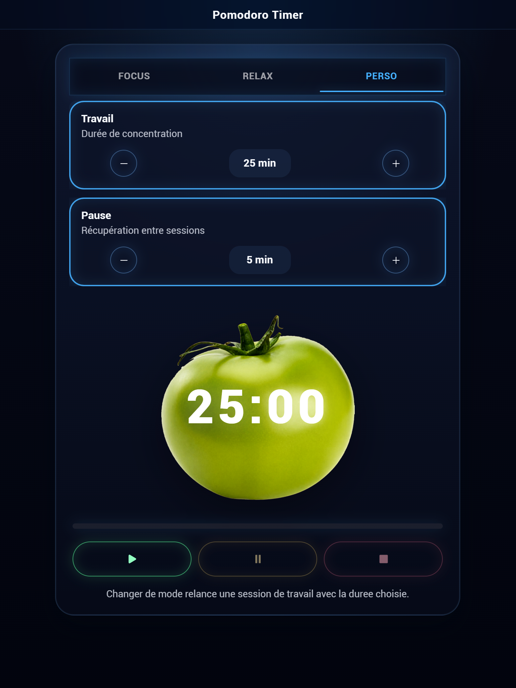

# Pomodoro Timer

A mobile-first Pomodoro timer built with Ionic 9, Angular 22, and Capacitor 8.
This repository also serves as a learning example for students, interns, and
developers getting started with this stack.



## Features

- `Focus`, `Relax`, and `Custom` modes
- Custom work and break durations
- French, English, and Spanish translations selected from the device language
- A tomato that changes from green to yellow to red and blinks in the last 10 seconds
- Native audio through `@capgo/native-audio`
- A responsive Ionic interface with a neon theme

## Stack

- Angular 22
- Ionic Angular 9
- Capacitor 8
- TypeScript 6.0
- Jasmine and Karma for unit tests
- ESLint 9 for TypeScript and Angular templates

## Requirements

- Node.js **22.23.3**, the version pinned in `.nvmrc` and used by CI
- npm, included with Node.js
- Google Chrome to run the Karma tests

The supported Node.js ranges are `^22.22.3`, `^24.15.0`, or `>=26.0.0`.
Using the pinned version keeps local development consistent with CI.

## Getting started

After cloning the repository, open a terminal in its root directory.
If you use nvm or nvm-windows, install and activate the pinned Node.js version:

```bash
nvm install 22.23.3
nvm use 22.23.3
```

On Windows, nvm may request administrator permission to switch Node.js versions.

Install the dependencies and start the development server:

```bash
npm ci
npm start
```

Open `http://localhost:4200/` in your browser. Changes to the source files are
reflected by the development server.

Use `npm ci` for a fresh installation from `package-lock.json`. Use `npm install`
when intentionally adding or updating a dependency, and commit both
`package.json` and `package-lock.json` when they change.

## Checks

Before committing a change, run the linter, tests, and production build:

```bash
npm run check
```

| Command | Purpose |
| --- | --- |
| `npm start` | Start the development server |
| `npm run build` | Create a production build in `www/` |
| `npm run watch` | Rebuild the development output when files change |
| `npm test` | Run Jasmine/Karma tests in Chrome and watch for changes |
| `npm run test:ci` | Run tests once in ChromeHeadless |
| `npm run lint` | Check TypeScript and HTML; warnings fail the check |
| `npm run check` | Run lint, tests, and the production build in sequence |

If Chrome is installed in a nonstandard location, set the `CHROME_BIN`
environment variable to the path of its executable.

The [CI workflow](.github/workflows/ci.yml) runs `npm ci` and `npm run check`
for pull requests and pushes to `main`.

## Understanding the application

Start with these files:

| File | Responsibility |
| --- | --- |
| [src/main.ts](src/main.ts) | Bootstrap Angular and configure Ionic, routing, HTTP, and translations |
| [src/app/app.routes.ts](src/app/app.routes.ts) | Define the application routes |
| [src/app/home/home.page.ts](src/app/home/home.page.ts) | Compose the home page |
| [src/app/components/pomodoro/pomodoro.component.ts](src/app/components/pomodoro/pomodoro.component.ts) | Manage timer state, session changes, and custom durations |
| [src/app/components/pomodoro/pomodoro.component.html](src/app/components/pomodoro/pomodoro.component.html) | Display the timer and handle user actions |
| [src/app/core/i18n.service.ts](src/app/core/i18n.service.ts) | Load translations and provide translated text |

The application runs without Zone.js. Timer state uses Angular signals: read a
value with `timeLeft()` and change it with `timeLeft.set(...)` or
`timeLeft.update(...)`. Angular tracks signal reads in templates and refreshes
the view when those values change, including updates from the timer interval.
Components use Angular 22's default `OnPush` change detection strategy.

Tests live next to the code they exercise in `*.spec.ts` files. Component tests
use `await fixture.whenStable()` to wait for rendering. The countdown regression
test checks that an asynchronous timer tick updates the displayed time without
forcing change detection.

## Native development

After changing web code or Capacitor dependencies, build the web application
and synchronize the native projects:

```bash
npm run build
npx cap sync
```

Open a native project:

```bash
npx cap open android
npx cap open ios
```

Android builds require Android Studio and the Android SDK. iOS builds require
macOS, Xcode, and CocoaPods. Web checks do not replace native builds and device
testing, especially for native audio.

The minimum iOS deployment target is **iOS 17**, matching the Safari/iOS support
baseline of [Angular 22](https://angular.dev/reference/versions#browser-support).

## Repository structure

- `src/app/`: components, home page, and translation service
- `src/assets/`: translations, images, and audio
- `src/testing/`: shared unit test helpers
- `android/` and `ios/`: Capacitor native projects
- `resources/`: icon and splash screen assets
- `screens/`: application screenshots

Dependencies, caches, coverage reports, and generated builds are ignored by Git.
The lockfile is tracked so contributors and CI install the same dependencies.

## Translations

Translation files are in `src/assets/i18n/`:

- `fr.json`
- `en.json`
- `es.json`

When adding a translation key, update all three files. French is the fallback
language for unsupported locales and missing translations.

## Contributing

Keep changes focused and explain their purpose. Add or update tests when
changing behavior, then run `npm run check`. Review `git diff` before committing
to ensure the change contains only the intended files.

Write commit messages in English with a short, imperative subject, for example
`fix: preserve custom durations when switching modes`. Explain compatibility
changes and validation in the commit body when relevant.

## License

This project is licensed under the MIT License. See [LICENSE](LICENSE).
